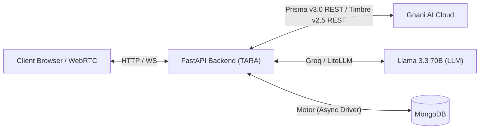

# TARA — Telephony Automated Recovery & Acquisition Agent

TARA is an AI voice agent platform for personal loan inquiries built on Gnani AI's Prisma v3.0 STT and Timbre v2.5 TTS, designed for Indian retail lenders. It pairs conversational voice outreach in Hindi, Telugu, and English with strict regulatory compliance gates (TRAI calling hours, DND filtering, cooling periods) and multi-tenant campaign management. Built from scratch for the Gnani AI Great Indian AI Internship Challenge, TARA orchestrates customer qualification, grounded information extraction, and automated retries.



## Gnani AI Model Usage & Boundary

| Capability | Component / Provider | Status & Model Notes |
|---|---|---|
| **Speech-to-Text (STT)** | **Gnani AI** | Prisma v3.0 REST (`/stt/v3`) with `indic-auto` auto-language detection |
| **Text-to-Speech (TTS)** | **Gnani AI** | Timbre v2.5 REST (`/api/v1/tts/inference`), voices: Nalini (en/hi), Suhana (te) |
| **Language Detection** | **Gnani AI** | `detected_language_code` returned directly by Prisma v3.0 |
| **Voice Orchestration** | *Custom (In-house)* | Custom WebSocket session manager (`app/voice/session.py`); Agent Builder / Evon NOT used |
| **LLM Reasoning** | *External (Groq)* | Llama 3.3 70B Versatile for single-turn pacing and grounded extraction |
| **Telephony Dispatch** | *Simulated Provider* | In-browser WebRTC tester (`TesterCallView`); Exotel/Twilio interface specified but mocked |

## Quickstart (6 Commands)

Clone the repo, set environment variables, install dependencies, seed data, and launch:

```bash
git clone https://github.com/[OWNER]/tara-gnani-ai.git && cd tara-gnani-ai
cp .env.example .env # Set GNANI_API_KEY, GROQ_API_KEY, MONGO_URI
cd backend && python -m venv .venv && .venv/Scripts/activate && pip install -r requirements.txt
python scripts/seed_data.py # Seeds demo bank, products, synthetic audience
uvicorn app.main:app --port 8000 &
cd ../frontend && npm install && npm run dev # Opens http://localhost:5173
```
*(Demo logins: `admin@testbank.com` / `password123` — demo credentials, synthetic data only).*

## 5-Step Evaluator Path

1. **Log in**: Navigate to `http://localhost:5173`, log in with `admin@testbank.com` / `password123`.
2. **Review Campaign**: Open **Campaigns** -> click *"Personal Loan Pre-Approved Q4"*, view the target audience, immutable snapshot, and voice settings.
3. **Trigger In-Browser Call**: Click **Launch** -> **Launch Single Tester Call**. Copy the generated tester token URL or click the launch button to open `TesterCallView`.
4. **Speak in Mic**: In `TesterCallView`, speak naturally in Hindi, English, or Telugu (e.g., *"मुझे तीन लाख रुपये का लोन चाहिए"*). Observe live STT transcription, LLM reply, and Timbre TTS audio streaming.
5. **Verify Outcomes & Compliance**: Open **History** & **Governance** to inspect grounded extraction JSON (`loan_amount_inr`, `interest_level`), TRAI calling window compliance audits, and latency breakdown.

## Measured Performance Numbers

- **Prisma v3.0 STT Latency**: Median 5,200 ms (REST indic-auto).
- **Timbre v2.5 TTS Latency**: Median 3,800 ms (synthesizing complete 16kHz WAV).
- **Turn Latency**: Sub-3s response when greetings and fillers hit pre-synthesized audio cache; ~9.2s on live end-to-end multi-cloud turns.
- **Noise Degradation (WER)**: Clean audio WER 0.12; 0.28 under 10 dB SNR white noise; 100% language detection accuracy across tested Indic dialects.
- **Compliance Precision**: 100% enforcement of TRAI 9 AM–8 PM calling windows, DND status, and 7-day cooldown rules.

## Honest Limitations

- **REST Latency**: Gnani Prisma v3.0 and Timbre v2.5 are consumed over REST endpoints, introducing ~5.4s STT and ~3.8s TTS turn overhead. Pacing fillers and greeting caching bridge this gap.
- **Agent Builder / Evon**: Gnani Agent Builder was unavailable under the provided hackathon API scopes, so all session state, turn pacing, and extraction were custom-built.
- **Synthetic Data**: Lead records, credit features, scoring weights, and acoustic noise tests were evaluated using synthetic generation pipelines, not proprietary banking records or field telephony.

## Repository Map

- `backend/app/main.py`: FastAPI app entrypoint, CORS configuration, and production guards.
- `backend/app/voice/session.py`: Real-time WebSocket session loop, turn pacing, and fallback recovery.
- `backend/providers/gnani_client.py`: Dedicated client for Gnani Prisma v3.0 STT and Timbre v2.5 TTS.
- `backend/app/communication/`: Compliance gate, task queue dispatcher, and provider abstraction.
- `backend/app/campaigns/`: Campaign wizard, audience filtering, and immutable snapshotting.
- `backend/scripts/`: Reproducible evaluation scripts (`noise_test.py`, `prompt_check.py`, `reset_demo.py`).
- `frontend/src/`: React + Vite operations console, Campaign Wizard, and `TesterCallView`.
- `docs/`: Comprehensive reports (`GNANI_NOTES.md`, `AUDIT.md`, `NOISE_TEST.md`, `EVIDENCE.md`).
