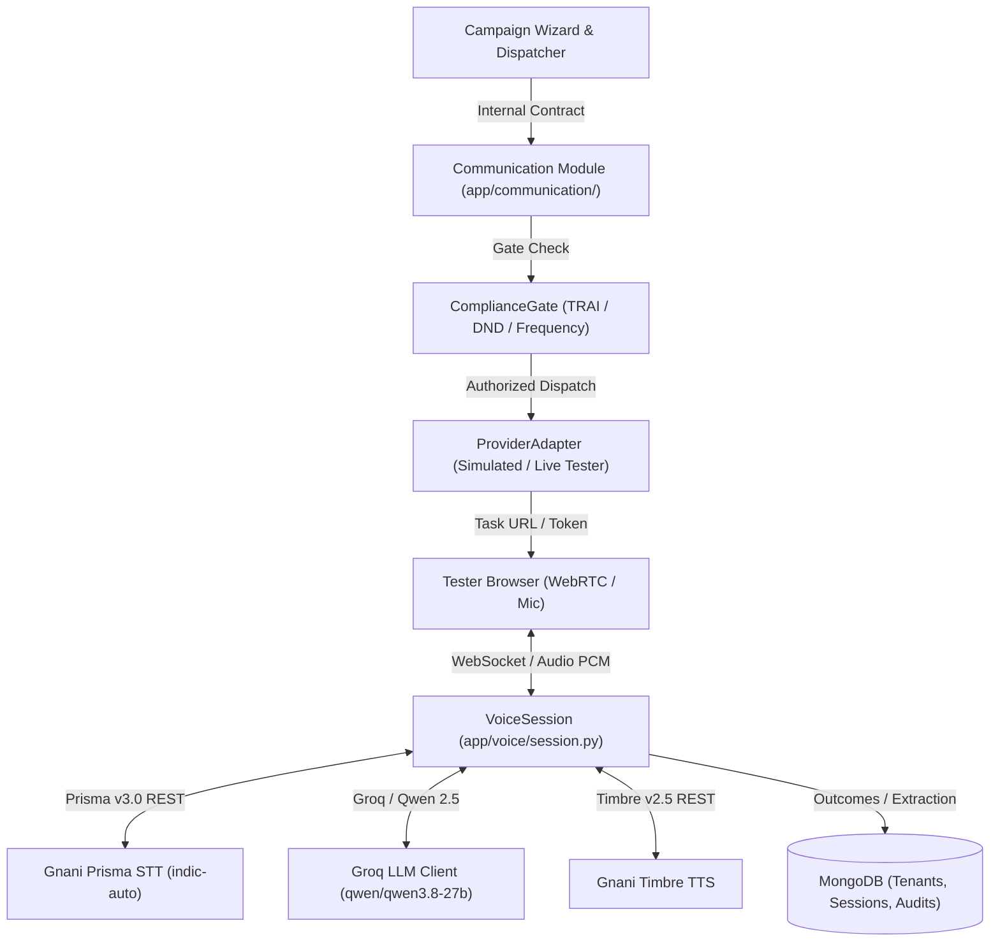

# TARA Architecture & System Design

> [!NOTE]
> Final Phase 7 architecture specification for TARA (Telephony Automated Recovery & Acquisition Agent).
> Fully implemented on FastAPI, MongoDB (Motor), Gnani AI Prisma v3.0, and Timbre v2.5.

## System Topology & Flow

## Architectural Isolation Boundaries

| Module | Allowed Imports | Forbidden Imports | Boundary Purpose |
|---|---|---|---|
| `app/campaigns/` | `app/contracts/communication.py`, `app/scoring/`, `app/db.py` | `app/communication/`, `providers/` | Campaign orchestrator knows nothing about low-level telephony or direct voice clients |
| `app/communication/` | `app/contracts/communication.py`, `providers/gnani_client.py` | `app/campaigns/` | Dispatcher & Compliance Gate execute communication requests strictly through abstract contracts |
| `providers/` | Standard libraries, `httpx`, `os` | Any `app.*` application logic | Dedicated isolation of vendor URLs, headers, and protocol formatting |
| `app/voice/` | `providers/`, `app/db.py` | `app/campaigns/` | Voice session maintains conversational loop independently of campaign workflow |

*Note: Enforced programmatically via AST inspection in `backend/tests/test_architecture_boundaries.py`.*

## Core Subsystems

### 1. Ingestion & Scoring Engine (`app/routers/importer.py`, `app/scoring/`)
- Multi-tenant CSV parser with schema validation and deduplication.
- Lightweight, zero-ML-dependency logistic scoring engine (`model_weights.json`) providing plain-English factor explanations alongside deterministic eligibility rules.

### 2. Campaign Management (`app/campaigns/`)
- Multi-step wizard with query-builder audience segmentation.
- Immutable campaign audience snapshots at launch ensuring auditing stability.
- Versioned voice configuration linking greetings, persona prompts, and language-specific voices.

### 3. Regulatory Compliance Gate (`app/communication/compliance.py`)
- **TRAI Calling Windows**: Blocks dispatches outside 09:00 to 20:00 IST.
- **National DND Filter**: Enforces hard rejection on active DND registrations.
- **Cooling Periods**: Prevents duplicate contact within a 7-day window.
- **Frequency Capping**: Maximum 3 contact attempts per 24 hours per customer.

### 4. Conversational Voice Loop (`app/voice/session.py`)
- Bi-directional WebSocket handling audio streaming, turn pacing, and barge-in.
- Multi-lingual STT auto-detection (`indic-auto`) across English, Hindi, and Telugu.
- Structured session outcome extraction (`interest_level`, `loan_amount_inr`, `callback_time`).
